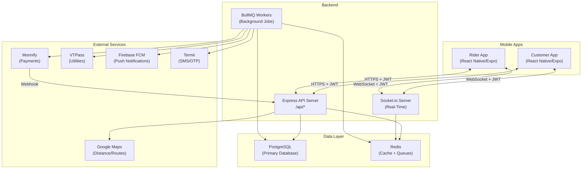
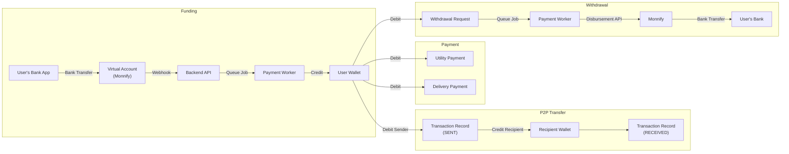
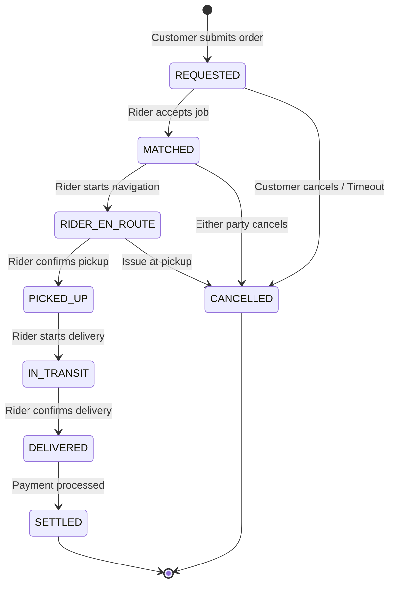
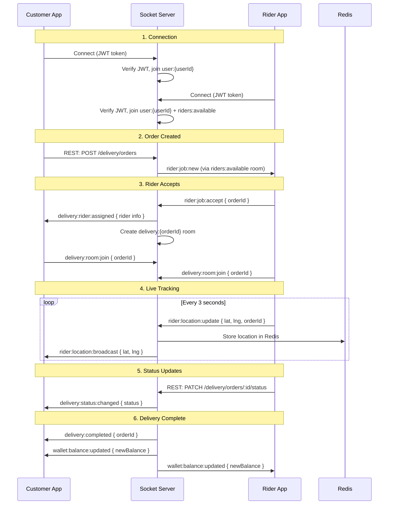

# System Architecture

## 1. High-Level System Diagram

## 2. Wallet Money Flow

## 3. Delivery Lifecycle State Machine

### Valid State Transitions

| Current State | Allowed Next States |
|---|---|
| `REQUESTED` | `MATCHED`, `CANCELLED` |
| `MATCHED` | `RIDER_EN_ROUTE`, `CANCELLED` |
| `RIDER_EN_ROUTE` | `PICKED_UP`, `CANCELLED` |
| `PICKED_UP` | `IN_TRANSIT` |
| `IN_TRANSIT` | `DELIVERED` |
| `DELIVERED` | `SETTLED` |
| `SETTLED` | (terminal) |
| `CANCELLED` | (terminal) |

## 4. Real-Time Socket Event Flow

## 5. Queue + Redis Integration

### Redis Usage Map

| Key Pattern | Data Type | TTL | Purpose |
|---|---|---|---|
| `rider:location:{riderId}` | JSON string | 30s | Latest rider GPS position |
| `rider:availability:{riderId}` | String | 1h | Rider online status |
| `delivery:active:{deliveryId}` | JSON string | 24h | Active delivery session cache |
| `otp:{phone}` | String | 10min | OTP code for verification |
| `session:{userId}` | String | 7d | Session tracking |
| `ratelimit:{ip}:{endpoint}` | Counter | varies | Rate limiting |

### Queue Processing Flow

## 6. Caching Strategy

| Data | Storage | Why |
|---|---|---|
| Rider GPS location | Redis only (30s TTL) | Updates every ~3s — too frequent for DB. Stale data self-expires. |
| Rider availability | Redis + DB | Redis for fast lookup, DB for persistence. |
| Active delivery sessions | Redis + DB | Redis for Socket.io room lookups, DB for durability. |
| OTP codes | Redis only | Short-lived, no persistence needed. |
| Wallet balances | DB only | Financial data — always from source of truth. |
| Transaction history | DB only | Append-only ledger — no caching. |
| Data plans (VTPass) | Consider Redis cache (5min TTL) | Reduce API calls to VTPass. |

## 7. Data Model Summary

See `backend/prisma/schema.prisma` for the complete schema. Key models:

| Model | Purpose | Key Relations |
|---|---|---|
| `User` | Core identity (customer, rider, admin) | Has one `Wallet`, optional `Rider` profile |
| `Wallet` | Financial balance + virtual account | Has many `Transaction` (debit/credit) |
| `Transaction` | Immutable financial ledger entry | Links to debit and/or credit wallet |
| `DeliveryOrder` | Delivery lifecycle tracking | Belongs to customer `User`, optional `Rider` |
| `Rider` | Rider profile + verification | Belongs to `User`, has many `DeliveryOrder` |
| `UtilityPayment` | Bill payment records | Belongs to `User` |
| `Rating` | Post-delivery rating | Links `DeliveryOrder`, `Rider`, `User` |
| `SavedBeneficiary` | Quick-access contacts/accounts | Belongs to `User` |
| `Session` | JWT refresh token tracking | Belongs to `User` |
| `WebhookEvent` | External webhook audit log | Standalone |
